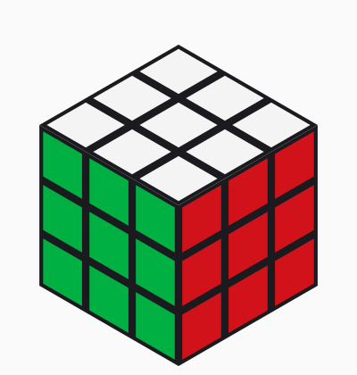

# rs3m-twin

A MuJoCo digital twin of the **MoYu Super RS3 M (Standard)** 3x3 cube, built for robot manipulation and RL.

<p align="center"></p>

## What's modelled

| | |
|---|---|
| Size / mass | 56 mm, 78 g (published Standard specs) |
| Turning | each face on a driven hinge, with friction, damping and armature |
| Magnets | 48 point-dipole magnets (`magnet_model="dipole"`), or a simple sin(4θ) detent (`"sin4"`) |
| Corner cutting | 50° forward / 35° reverse; past that the shared piece catches and the turn jams |
| Jamming | catch torque (`mechanism="torque"`, default, fast) or internal-part contact (`"contact"`) |
| Look | stickerless coloured plastic; collision shapes hidden in group 3 (`visual_style="debug"` shows them) |

## Install

```bash
pip install -e .[test]
pytest
```

## Use

RL environment:

```python
import gymnasium as gym
import rs3m_twin.env  # registers RS3M-v0

env = gym.make("RS3M-v0")  # physics randomised on every reset
obs, info = env.reset(seed=0)
```

Add the cube to your own scene:

```python
from rs3m_twin.params import CubeParams
from rs3m_twin.mjcf import build_mjcf

xml = build_mjcf(CubeParams())
```

Drive it directly:

```python
from rs3m_twin import CubeSim

sim = CubeSim()
sim.apply_moves("R U R' U'")
print(sim.facelets())  # 54-char Kociemba string
```

## Scripts

- `scripts/demo.py out.mp4 --moves "R U R' U'"` renders a video (needs OpenGL)
- `scripts/bench.py` times a 20-move scramble + inverse (~2 s)
- `rs3m_twin/tune.py` fits params from a CSV of measurements
- `rs3m_twin/video_fit.py` fits friction, damping and magnet strength from a slow-motion video of a turn

## Accuracy

Size, mass, magnet count and corner-cutting angles come from published specs and reviews. Friction, damping, magnet strength and internal part dimensions are **estimates**: keep randomisation on, and fit them from a 240 fps video of a real cube with `video_fit.py` before relying on sim-to-real transfer.
